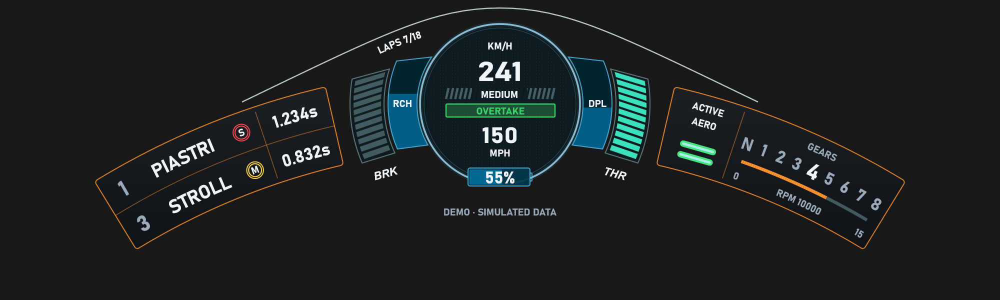

# f1 tv

Modello Halo nativo Direct2D con gli indicatori del riferimento McLaren e
geometria simmetrica basata sulle curve di Shift. Si seleziona in
**Halo & layout → Halo model → f1 tv → Apply and save**.

Arco bianco e quadrante condividono il centro della finestra Halo. Le ali
usano lo stesso raggio di Shift, estremi speculari, spessore e cornici uguali.
I due riquadri laterali hanno altezza di 80 unità, ridotta del 20% rispetto
alla versione precedente. Margini e righe sono riallineati senza ridurre
dimensione o proporzioni dei testi.
Entrambi i riquadri sono rialzati di 20 unità insieme al proprio contenuto,
con uno spostamento identico sui due lati e spazio libero sotto l'arco bianco.
Testi, divisori e barra RPM seguono la medesima curvatura. La classifica ha
due righe equidistanti con sigle pilota di tre lettere.
A destra, GEARS, numeri delle marce, barra e didascalia RPM hanno
quattro righe dedicate, con margini separati.

Nello spazio sotto l'arco bianco, a sinistra del quadrante, il contatore
**LAPS giro/totale** segue la curvatura dell'arco.
Testo e numeri sono ridotti del 40% rispetto alla prima versione del contatore.
Il giro corrente proviene da Lap Data della vettura locale e il totale da Session, per esempio
**LAPS 7/18**. Quando uno dei due dati manca, vale zero o scade, mostra
**LAPS --/--** in grigio. Il contatore richiede una sessione attiva in pista.

Il quadrante mostra km/h e mph, convertiti dalla stessa velocità UDP.
La scritta centrale indica la modalità ERS ricevuta: **NONE**, **MEDIUM**,
**HOTLAP** o **BOOST**. OVERTAKE si evidenzia quando disponibile o attivo.
La batteria, centrata sul quadrante compreso il terminale laterale, mostra
la percentuale al posto del fulmine. La percentuale usa la capacità nominale
letta dal gioco; senza capacità o status valido mostra `--%`.

Una fascia sotto il quadrante mostra gli avvisi di gara: bandiere gialla,
verde, blu, rossa e a scacchi, Safety Car/VSC, penalità e warning ufficiali.
Usa gli stessi dati, colori, priorità e durata di Shift: al massimo cinque
secondi, con rimozione anticipata per stato terminato, dati scaduti o pausa.
Resta separata dalla batteria, dagli altri indicatori e dalla scritta Demo.
Senza un avviso valido la fascia non viene disegnata.

Le fasce **RCH** (recharge) e **DPL** (deploy) seguono il cerchio e affiancano undici segmenti per
ciascun pedale, con le etichette **BRK** e **THR**. Il riempimento blu indica
la quota ancora disponibile nel giro, senza valori numerici in MJ.
Le due sigle sono centrate nei contenitori, su una sola riga
con spaziatura naturale. RCH sottrae l'energia MGU-K già raccolta dal limite UDP
del giro, che può cambiare durante la sessione. DPL sottrae l'energia
già usata dal limite nominale `DeployLimitMGUK` letto dai file installati.
Capacità batteria e limiti per giro sono denominatori distinti. Al reset dei
contatori UDP nel nuovo giro, le fasce tornano piene. Il residuo non scende
sotto zero; dati mancanti o scaduti lasciano il riempimento spento e la sigla attenuata.
Il pedale acceleratore usa il verde menta del riferimento quando il colore
globale è quello predefinito; un colore personalizzato viene rispettato.

Il pannello sinistro mostra l'auto immediatamente davanti nella riga superiore
e quella immediatamente dietro nella riga inferiore. Ciascuna riga contiene
posizione in classifica, sigla pilota, gomma montata e distacco dalla propria
vettura in una colonna dedicata, per esempio **1.234s**. Le sigle vengono
ricavate dai nomi di Participants, per esempio **NOR**, **LEC** e **VER**;
nome completo e accenti latini sono gestiti, insieme alle eccezioni
**MSC/RSC**, **DEV** e **ZHO**. Per gli altri nomi si usano fino a tre caratteri
alfanumerici dell'ultima parola, in maiuscolo. Le
posizioni, identità degli avversari e intervalli provengono da Lap Data.
La gomma usa il modello **B**, a doppio anello: **S rossa**, **M gialla**,
**H bianca**, **W blu** e **I verde**. La lettera è centrata sul simbolo e
segue l'inclinazione del pannello. Le sigle mantengono dimensione e posizione
dei caratteri e rimangono distanziate dall'icona prima del divisore del gap.
La mescola visuale proviene da Car Status per l'indice dell'avversario:
si aggiorna al cambio gomme e al cambio dell'auto davanti o dietro.
Dati assenti, scaduti o codici non supportati mostrano un anello grigio con `?`.
I nomi restano validi dieci secondi
fra gli invii Participants, documentati ogni cinque secondi. Posizioni,
pedali e stati rapidi scadono dopo 500 ms. Nomi vuoti, UTF-8 non valido,
caratteri di controllo e dati assenti producono `--`. La riga relativa all'auto
davanti rimane senza dati quando si è primi; lo stesso vale per quella dietro
quando si è ultimi. I distacchi mostrano tre decimali sotto 100 secondi,
uno sotto 1000 e secondi interi per intervalli maggiori, per mantenere leggibile
la colonna. Un distacco valido di zero viene mostrato come **0.000s**.

La colonna dei distacchi occupa lo spazio del precedente riquadro TURN.
ACTIVE AERO mostra due tratti orizzontali in Straight Mode e inclinati in
Corner Mode. I tratti sono allungati del 20% mantenendo centro e spessore interno.
Un bordo colorato di 2 unità logiche circonda singolarmente ciascun tratto, estremità
comprese: verde quando l'aerodinamica è attiva, rosso quando è inattiva.
La sola disponibilità non rende verde il
bordo; dati assenti, scaduti o non applicabili mantengono il bordo spento.
Il pannello destro evidenzia la marcia ricevuta, compresa R. La scritta sotto
la barra mostra i giri attuali per intero, per esempio **RPM 10000**; senza
telemetria valida mostra **RPM --**. La barra resta relativa al limite
effettivo della vettura.

Posizione, scala e trasparenza seguono i normali controlli Halo. L'allineamento
con la vettura richiede una regolazione sulla visuale e sul FOV usati nel gioco.
I profili Halo consentono di conservare tale regolazione per ciascuna visuale.

Il nuovo modello conserva gli altri modelli e il pannello pneumatici corrente.
La modalità Demo rimane identificata con **DEMO · SIMULATED DATA**.

## Ala sinistra Time Trial

La sessione UDP di tipo 18 seleziona automaticamente il pannello TT; gli altri
tipi mantengono il pannello piloti precedente. **F1 TV left panel** nel menu
rapido permette di scegliere Automatic, Race o Time Trial. La forzatura resta
attiva nella sessione corrente, anche dopo pausa, flashback, cambio modello o
applicazione delle impostazioni. Nuova sessione, Session Start/End, riavvio
della sessione o cambio sorgente la riportano ad Automatic; non viene salvata
nel JSON.

TT mostra delta con segno e millesimi, tempo corrente in minuti/secondi/millesimi,
stato VALID/INVALID e tre tempi di settore. Il settore corrente avanza usando
il cronometro ricevuto meno i settori già conclusi; gli split conclusi mostrano
anche il confronto con lo stesso settore del riferimento. Verde indica un
vantaggio, rosso un ritardo o un giro invalidato. Un giro invalidato continua
a mostrare il cronometro e il delta rispetto al riferimento valido.

In modalità TT il mini HUD pneumatici si nasconde automaticamente, lasciando
solo Halo. La regola segue la modalità automatica della sessione e la selezione
manuale TT/Race. Tornando a Race, il mini HUD riprende la visibilità salvata;
la sua preferenza non viene modificata dal cambio di modalità.

Il riferimento è il miglior giro valido della sessione per cui è stata acquisita
una traccia completa. Il suo tempo deve coincidere con il miglior tempo valido
noto della sessione: un giro più lento non sostituisce una traccia mancante del
vero migliore. Nessun personale storico, rivale o ghost viene usato al suo posto.
L'identità del riferimento rimane fissa fino al traguardo. Un giro valido migliore
lo sostituisce soltanto all'inizio del giro successivo. Un'invalidazione tardiva
confermata dallo storico elimina il riferimento senza sceglierne un altro
durante il giro in corso.

**TT · NO VALID REF** segnala l'assenza di un giro valido di riferimento;
**TT · NO LAP TRACE** segnala un miglior tempo noto senza traccia utilizzabile.
In entrambi i casi il delta è `--`. Dati TT mancanti o scaduti mostrano trattini.
Fondo, contorno e ingombro dell'ala restano gli stessi. In Race la funzione
originale che disegna piloti, nomi, gomme e distacchi resta invariata.
